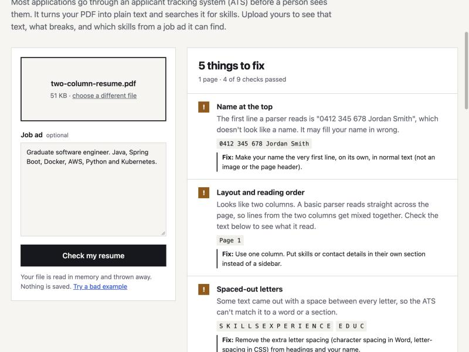
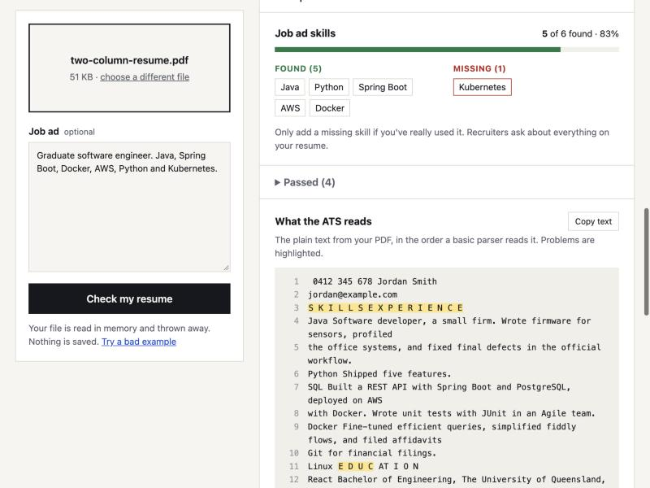

# ATS Checker

[](https://github.com/DarcyMF/ats-checker/actions/workflows/ci.yml)

Upload a resume PDF and see the plain text an applicant tracking system (ATS) gets out of it, what breaks, and which skills from a job ad it can find.



## Why I made this

I ran my own resume through a PDF text extractor and found my name split in two and "fi" turned into one symbol, so a search for "firmware" didn't find it. On screen it looked fine. The paid checkers give you a score out of 100, but I wanted to see the actual text, so I built this.

## What it checks

| Check | Why it matters |
| --- | --- |
| Readable text | A scanned or image-only PDF has no text, so the ATS sees a blank page |
| Name at the top | Parsers usually take the first line as your name |
| Contact details | Email and phone need to be plain text, not icons or images |
| Columns | A basic parser reads straight across the page and mixes a sidebar into your experience |
| Joined letters | Fonts like Calibri join "fi" and "fl" into one character, which breaks keyword search |
| Icons | Icon fonts come out as unreadable characters |
| Spaced-out letters | Wide letter spacing turns EXPERIENCE into E X P E R I E N C E |
| Section headings | Standard headings tell the ATS where Experience, Education and Skills start |
| Length | Graduate resumes are expected to be one or two pages |
| Job ad skills | Lists the skills from the ad that the resume has, is missing, or has but can't be read |

It also shows the extracted text with the problems highlighted:



## How it works

```
PDF upload ──> PDFBox ──> text + character positions ──> 9 checks ──> JSON ──> React page
                                                    └──> skills from job ad ┘
```

- **Backend:** Java 21, Spring Boot, Apache PDFBox. `POST /api/check` takes the PDF and an optional job ad and returns the results as JSON.
- **Frontend:** React and TypeScript, built with Vite. The build goes into Spring Boot's `static` folder, so it deploys as one app.
- **Privacy:** the PDF is only ever held in memory. Nothing is written to disk or logged.

### A few decisions

- **Two versions of the text.** PDFBox quietly turns "fi" back into "fi". That's helpful, but it hides the problem, so I rebuild the text a second time from the raw characters. If a skill only matches in the cleaned-up version, it's reported as "in your resume but unreadable".
- **Finding columns.** I cut the page into 120 thin vertical strips and count how many characters touch each one. In a one-column resume, full-width lines cross the middle, so every strip there is busy. A strip that's empty from top to bottom, with plenty of text on both sides, means two columns. Dates pushed to the right edge don't set it off, because the bullet points under them still cross the middle (there's a test for that).
- **Skills that are also normal words.** The skill list is a plain text file (`skills.txt`). Short names like C and R are case-sensitive, and so are words like React and Excel, so "react quickly" and "excel at" in a job ad don't count. C doesn't match inside C++, Git doesn't match inside GitHub, and SQL doesn't match inside MySQL.
- **What it can't do.** Real ATSs vary, and the expensive ones are better at columns and tables than this is. It shows what a basic parser sees, so if this reads your resume correctly, they will too.

## Run it locally

You need Java 21+ and Node 22+.

```bash
cd frontend && npm ci && npm run build && cd ..
mvn spring-boot:run
```

Then open http://localhost:8080.

Or with Docker:

```bash
docker build -t ats-checker .
docker run -p 8080:8080 ats-checker
```

To work on the page with hot reload, run `mvn spring-boot:run` and `npm run dev` in `frontend/` at the same time. Vite proxies `/api` to port 8080.

## Tests

```bash
mvn test
```

39 JUnit tests. Most of the test PDFs are generated in code with PDFBox (a two-column page, a scanned page, a page with right-aligned dates), so there are no binary fixtures in the repo. GitHub Actions runs the tests, builds the front end and builds the Docker image on every push.

## Deploying

`render.yaml` deploys the Dockerfile to Render's free tier. Connect the repo in Render as a Blueprint and it builds from there.

## Ideas for later

- Read .docx files as well as PDFs
- Detect tables, which some parsers skip completely
- Spot contact details that only exist in the page header
